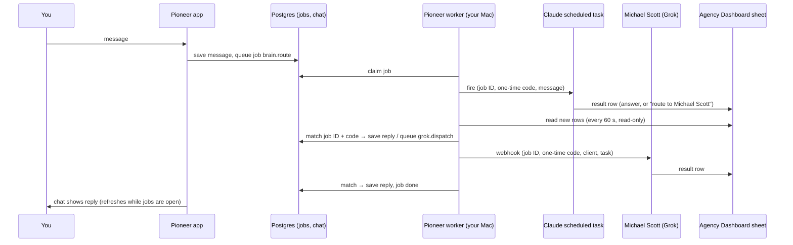

# Milestone 8: Pioneer loop

Status: **Built, waiting for Step 0 and the live test** · 2026-10-24 · Branch `feat/m8-pioneer-loop`

Replaces the old "M8 = release" from `docs/os3/`. Built on decisions D-29 to D-35.

## Goal

You talk to Pioneer. Pioneer (Claude, via your scheduled task) works out what you need and
either answers or routes the work to Michael Scott (Grok). Results from both come back into
Pioneer through the Agency Dashboard sheet. Every step is a job with a log entry; anything
sensitive waits for your approval. Runs on your Mac; no pay-per-use API keys.

## How it works

- **The app never holds the webhook keys.** Only the worker reads `GROK_WEBHOOK_*`,
  `CLAUDE_ROUTINE_*` and the Google key. The app only writes messages and queues jobs as you.
- **The worker** is a small TypeScript process (`npm run worker`) using the existing
  `pioneer_worker` database role and `worker.*` functions from M7. It runs no agent code and no
  shell commands; it only makes HTTP calls, so the container rule (D-32) is untouched.
- **Sheet rows are untrusted.** A row counts only if its job ID and one-time code match an open
  job, the code hasn't been used and hasn't expired. The text is shown as plain text, never
  treated as instructions, approvals or prices.
- **No money limits in Pioneer.** Your plans cap usage; keep usage credits off in Claude settings. Pioneer only has a loop brake.
- **No automatic resends.** The Claude fire endpoint has no duplicate protection, so a failed
  fire is marked failed for you to retry by hand. The Grok webhook gets the same rule.

## Step 0: verify the way back (before any code)

| Check | How | If it fails |
|---|---|---|
| Claude task can write a row to the sheet | Update "Pioneer brain test" to append one row through the Google Drive connector (only that connector) | Fallback: a results endpoint on Pioneer behind a free Cloudflare Tunnel, with per-job keys (`PLAN.md` §3.3). Needs your OK |
| Michael Scott writes rows in the agreed format | Send one fake task with a job ID and code | Adjust the format with him |
| Pioneer can read the sheet | Service account with read-only access to that one sheet | Fix sharing |

## Database (`supabase/migrations/20261025000100_pioneer_loop.sql`)

| Change | Purpose |
|---|---|
| `conversations`, `messages` (author: you / Pioneer / Michael Scott; job link; plain text ≤ 20 000 chars) | Chat history in Postgres |
| `jobs.status` adds `waiting_external`; `jobs.external_ref`, `jobs.waiting_until` | Job waits for a sheet row |
| `job_result_codes` (job, code hash, expires, used_at) | One-time codes; only hashes are stored |
| `sheet_rows_seen` (sheet row key, job, outcome) | Each row is processed once; unknown rows are recorded as ignored |
| `worker.mark_waiting`, `worker.accept_result(job, code, payload)`, `worker.record_ignored_row`, `worker.add_message` | Worker API; no table access, as in M7 |
| `agents`: `kind` (`claude_task`, `grok_team`), `integration_state`, `last_verified_at`; seed **Pioneer (Claude)** and **Michael Scott (Grok)**; retire the 8 M7 roles (inactive, history kept) | D-29, D-30 |
| `proposed_actions.payload` + `payload_sha256`; approval binds to the hash | Automatic proposals can't change after you approve |
| `connection_brakes` (per connection: max 20 tasks per rolling hour; when hit, that connection pauses and you are told; you resume it) | Loop protection. Spending is capped by your Claude and Grok plans (D-33) |

RLS, grants and pgTAP tests for every new table, as in M1–M7.

## Worker (`worker/`)

| File | Does |
|---|---|
| `index.ts` | Loop: claim jobs, heartbeat, poll the sheet every 60 s, stop on kill switch |
| `handlers/brain-route.ts` | Fire the Claude task with job ID, code and the message |
| `handlers/grok-dispatch.ts` | Call Michael Scott's webhook; runs the M6 sensitive-data scan first and blocks contact details |
| `sheet.ts` | Read new rows (Google Sheets API, read-only scope) |
| `results.ts` | Validate a row (Zod), match job and code, save the reply or queue the next step |
| `brakes.ts` | Check the hourly brake before every fire; pause the connection and tell you when hit |
| `*.test.ts` | Unit tests with a fake webhook, fake fire endpoint and fake sheet |

## App

| Where | What |
|---|---|
| `/pioneer` (new, sidebar "Pioneer") | Chat: send a message, see replies and job status; refreshes while a job is open. iPhone dictation works in the text box |
| Dashboard | Tiles: open jobs, waiting for you, usage this month |
| Agents → Roster | Pioneer (Claude) and Michael Scott (Grok) with connection state and last verified time |
| Agents → Jobs | Shows `waiting_external` and which sheet row answered |
| Agents → Usage | Tasks this hour and month per connection, brake state, resume button |
| Clean-up | Remove "Hermes" wording; nav milestone 8; fix the database test that depends on leftover data |

Before coding the chat page: read `01-app/02-guides/interactive-apps.md`,
`01-app/01-getting-started/07-mutating-data.md` and `15-route-handlers.md` in
`node_modules/next/dist/docs/` (AGENTS.md).

## Tests and acceptance

| # | Criterion | Evidence |
|---|---|---|
| 1 | A message creates exactly one `brain.route` job; viewers can't send | pgTAP, Playwright |
| 2 | A sheet row with a wrong, used or expired code is ignored and logged; a correct one completes the job once | pgTAP, worker unit tests |
| 3 | Kill switch stops claims and fires; resume continues | pgTAP, worker test |
| 4 | The 21st task within an hour on one connection is not sent; the connection pauses, you see it, and resume works | pgTAP, worker unit test |
| 5 | Webhook payload never contains contact details; secrets never appear in logs, results or the database | unit tests, log check |
| 6 | Approving a proposed action binds to its payload hash; a changed payload can't be executed | pgTAP |
| 7 | **Live test:** "draft a follow-up for test client" from the chat → Pioneer routes to Michael Scott → his row in the sheet → reply in the chat | Screenshots, job and audit entries |

Plus everything that runs today: lint, typecheck, unit, database and end-to-end tests, in CI on
the merge request.

## What you do

| When | Task |
|---|---|
| Before Step 0 | Create the Google service account and share the Agency Dashboard sheet with it as **Viewer** (I'll write the steps) |
| Step 0 | Paste my instructions into the Claude task and send Michael Scott the result format |
| End | Run the live test and approve the merge |

## Not in M8

Coding by agents, Google Drive folders, Dropbox, the iPhone home-screen app, the Website Demo
workflow, a VPS. The worker only runs while your Mac is awake.

## Rollback

One forward migration and new code on one branch. Before merge: drop the branch. After merge: a
follow-up migration reverses it, the kill switch stops all agent work at once, and stopping the
worker leaves the app working as it does today.

## As built (2026-10-24)

Differences from the plan above:

- **One conversation per workspace**, so there is a `messages` table but no `conversations`
  table. A second conversation can be added later without changing existing rows.
- **Worker secrets live in `.env.worker`**, not `.env.local`. Next.js loads every variable in
  `.env.local` into the app, so this is the only way the app never holds the webhook keys.
  `.env.worker.example` documents the settings.
- **`usage_limits` became `connection_brakes`** (D-33 as revised): a loop brake of 20 sends per
  rolling hour per connection; no monthly limit, because your plans cap usage.
- **Grok is allowed as an agent provider again** (D-36, proposed): Michael Scott's record uses
  `xai`; budgets and the cost ledger still refuse it.
- **Routed tasks are scanned again** before they reach Michael Scott; contact details or keys
  block the send. Messages you write yourself are scanned when you send them and need your
  confirmation.
- **Not in M8: payload-bound approvals (acceptance #6).** Nothing in M8 creates proposed actions
  automatically: replies are shown as text only, so there is nothing new to bind yet. Moved to
  the milestone where agents first propose actions.
- **Pioneer (Claude) sees only your message**, not Pioneer's records. Giving it read access to
  client data is a later, separately approved step.

Evidence so far (local):

| Check | Result |
|---|---|
| Database tests | 418 / 418 (76 new in `011_pioneer_loop.test.sql`) |
| Unit tests | 187 / 187 (20 new for the worker) |
| Lint, format, typecheck, database lint | Clean |
| Worker smoke test (no outside connections) | Claimed one message and failed it with "not set on this Mac"; no secrets in the log |
| End-to-end | See the merge request |
| Step 0 and live test | Waiting for your setup (docs/runbooks/m8-setup.md) |
