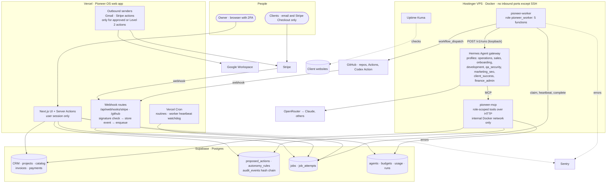
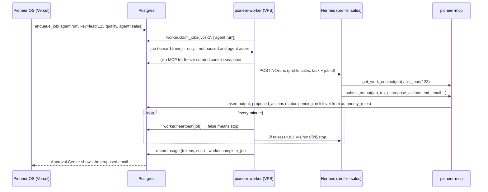

# Pioneer OS 3.0 architecture

Status: M7 (job queue, kill switch, roster) is built; everything else on this page is design.
Builds on [../architecture.md](../architecture.md) (the as-built web app) and
[../security.md](../security.md).

## 1. Principles

1. **Pioneer OS is the source of truth.** Clients, projects, payments, approvals, workflow
   state and the audit log live in Supabase Postgres. Nothing else is authoritative.
2. **Hermes orchestrates; it does not decide.** Hermes reasons, drafts, plans and calls tools.
   Whether something may happen is decided by deterministic code in Pioneer OS.
3. **Deterministic code for rules.** Payment verification, access control, workflow
   transitions, billing, idempotency, retries and approvals are SQL/TypeScript with tests. AI is
   used for reasoning, content and complex technical work.
4. **Every event goes through a durable job.** The pipeline is:
   `business event → Pioneer OS backend → jobs table → worker → Hermes (if reasoning is needed)
   → verification → database update → approval or next step`.
   Conversation history, agent memory and cron are never the record of business state.
5. **Least privilege everywhere.** Each component gets the narrowest credential that works,
   and none of them can approve its own actions.
6. **Cheap and boring.** One VPS, one Hermes install, Postgres as the queue, free tiers where
   they suffice.

## 2. Components

| Component | Runs on | Credential it holds | Can | Cannot |
|---|---|---|---|---|
| Web app (UI, Server Actions) | Vercel | Supabase anon key + the signed-in user's session | Everything the user's role allows, re-checked by RLS | Bypass RLS; act without 2FA |
| Webhook routes | Vercel | Stripe and GitHub webhook signing secrets; a Postgres login for role `pioneer_ingest` that can only call `ingest.record_event()` (M12). No service-role key. | Verify signatures; insert an event once; enqueue a job | Run business logic inline (they only record and enqueue) |
| Outbound senders | Vercel (server) | Gmail OAuth refresh token, Stripe restricted key | Send exactly what an approved/Level 2 action says | Send anything without `require_approved_action` or a Level 2 rule match |
| `pioneer-worker` | VPS | Postgres login for role `pioneer_worker`; Hermes API key; GitHub fine-grained token (Actions: write on chosen repos) | Claim/heartbeat/complete/fail jobs; start Hermes runs; trigger Codex workflows | Read or write any table directly |
| Hermes Agent | VPS | OpenRouter key (with monthly limit); per-profile MCP tokens; Telegram bot token (optional) | Reason, draft, call the MCP tools its profile allows | Touch the database, Gmail, Stripe or production directly |
| `pioneer-mcp` | VPS | Postgres login for role `pioneer_mcp` (M10), limited to `mcp.*` functions | Expose role-scoped tools (below) | Approve, send, deploy, change billing |
| Uptime Kuma | VPS | none (read-only checks) | Probe client sites, push alerts to a Pioneer OS webhook | — |

### Why the worker and Hermes live on the VPS but webhooks don't

Webhooks need a public HTTPS endpoint with high availability; Vercel already provides that
for Pioneer OS. Keeping them there means **the VPS needs no inbound ports at all**: the worker
pulls jobs from Postgres, Hermes's Telegram gateway long-polls Telegram, and Uptime Kuma pushes
outward. SSH (key-only, restricted source IPs) is the only way in.

### Why Postgres is the queue

The `jobs` table (M7) gives durable, transactional, auditable jobs with no extra service:
leases with `FOR UPDATE SKIP LOCKED`, exponential backoff, a dead-letter ("gave up") state,
per-attempt history and idempotency keys. At Pioneer Digital's volume (hundreds of jobs a day,
not millions) it is plenty. Alternatives considered: Supabase Queues (pgmq), which is fine but
adds a second model for the same thing; Redis/BullMQ, which adds a paid or self-run service.

## 3. How a job flows (agent example)

- **Idempotency:** each job has `(workspace, kind, idempotency_key)` unique; outbound actions
  carry the action id as their idempotency key (Stripe `Idempotency-Key`, Gmail message header
  `X-Pioneer-Action`), so a retried job cannot double-send.
- **Lost lease:** if the worker dies, `worker.reap_expired()` returns the job to the queue after
  `timeout_seconds`; `complete_job` from a stale worker returns `false` and its result is dropped.
- **Kill switch:** pausing the workspace makes `claim_jobs` skip agent jobs, `heartbeat` return
  `false` for running ones, `ai_budget_allows` return `false`, and dispatch fail.

## 4. Hermes integration details (verified against Hermes docs, Oct 2026)

| Topic | Choice | Hermes feature used |
|---|---|---|
| Install | Official Docker image `nousresearch/hermes-agent`, `gateway run`, data volume `~/.hermes:/opt/data`, runs as non-root UID 10000 | [Docker setup](https://hermes-agent.nousresearch.com/docs/user-guide/docker) |
| Roles | One Hermes **profile per role**: own config, memory, sessions, skills | Profiles |
| Starting work | Worker calls the **API server** `POST /v1/runs` on loopback/internal network, bearer `API_SERVER_KEY`; watches `/v1/runs/{id}/events`; stops with `/v1/runs/{id}/stop` | [API server](https://hermes-agent.nousresearch.com/docs/user-guide/features/api-server) |
| Tools | Hermes is an **MCP client**; each profile lists only `pioneer` MCP server with `tools.include` set to its allowed tools and its own bearer token | [MCP](https://hermes-agent.nousresearch.com/docs/user-guide/features/mcp) |
| Command execution | `terminal.backend: docker` (sandboxed, `--cap-drop ALL`); `approvals.mode: manual`; `approvals.unattended_mode: deny`, `cron_mode: deny` so headless runs can never auto-approve risky commands; `approvals.deny` patterns for `git push*main*`, `vercel --prod*`, `psql*`, `curl*stripe*` | [Security](https://hermes-agent.nousresearch.com/docs/user-guide/security) |
| Secrets | `~/.hermes/.env` `chmod 600`; `auth.adopt_external_logins: false`; no `docker_forward_env` of business secrets | Security |
| Network | `security.allow_private_urls: false` (blocks the agent's browser and web tools from reaching internal addresses); dashboard bound to `127.0.0.1` and reached by SSH tunnel; API server not published to the host | Docker, Security |
| Chat | Optional Telegram gateway with `TELEGRAM_ALLOWED_USERS` = your user id only; everything else denied by default | Messaging gateway |
| Webhooks into Hermes | **Not used.** Events enter through Pioneer OS jobs instead, so there is one front door | — |
| Models | OpenRouter (single key, per-key monthly limit, provider allowlist, zero-data-retention option) | [OpenRouter guardrails](https://openrouter.ai/docs/guides/features/guardrails) |

Unverified, to confirm in M10 before relying on it: exact profile creation commands inside the
container, whether the run-status payload includes token usage (otherwise usage is read from
OpenRouter's key usage), and per-profile API server ports.

## 5. Codex and the development pipeline (M14)

The Development Agent does not run Codex on the VPS. It asks the worker to dispatch a GitHub
Actions workflow that uses the official **Codex GitHub Action** (`openai/codex-action@v1`,
`OPENAI_API_KEY` stored as a GitHub secret, `sandbox: workspace-write`). Code runs in GitHub's
runner, writes to a feature branch and opens a pull request. CI, Vercel preview and QA follow.
`main` is protected (required checks and review), so nothing an agent does can reach
production without your approval. Cursor stays your optional interactive editor.

## 6. Environments

| Environment | Database | App | Agents |
|---|---|---|---|
| Local (now) | Supabase CLI in Docker (OrbStack) | `npm run dev` | Hermes in Docker locally (M10), OpenRouter key with a $5 limit, synthetic data only |
| Staging | Separate Supabase project (free tier) | Vercel preview deployments | Optional; synthetic data only |
| Production | Supabase Pro | Vercel Pro, your domain | Hermes on the VPS |

Mocks and sandbox credentials are allowed only in local and staging, and are labelled as such
in config (`PIONEER_ENV=local|staging|production`; integrations refuse to start with test keys in
production and live keys outside production).

## 7. Observability

- **Errors:** Sentry (free Developer plan) in the web app and the worker; personal data scrubbed.
- **Jobs:** Jobs tab (status, attempts, errors), `job.*` audit events, dead-letter list.
- **Heartbeats:** worker writes a heartbeat; Vercel Cron alerts you (email) if it is older than
  10 minutes. This catches a dead VPS, which Uptime Kuma on the same VPS cannot.
- **Costs:** usage ledger per provider and role, OpenRouter key usage, monthly budget bars.
- **Uptime:** Uptime Kuma for client sites and Pioneer OS; alerts become incidents (M15).
