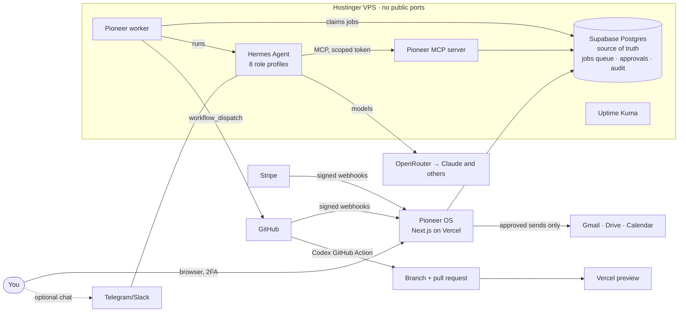

# Pioneer OS 3.0: review and plan

Written 2026-10-21 for the owner of Pioneer Digital, and for any engineer or agent who later
works on this repository. This page is the short answer; the linked documents hold the detail.

| Document | What it answers |
|---|---|
| [PIONEER_OS_SETUP_GUIDE.md](PIONEER_OS_SETUP_GUIDE.md) | What to buy, what it costs, and how to set up each service |
| [INTEGRATIONS_CHECKLIST.md](INTEGRATIONS_CHECKLIST.md) | Tick-list of accounts, and what to bring back (never the secrets themselves) |
| [ARCHITECTURE.md](ARCHITECTURE.md) | The complete system, with a diagram |
| [DATABASE_SCHEMA.md](DATABASE_SCHEMA.md) | Existing tables and the tables each phase adds |
| [AGENT_ROLES_AND_PERMISSIONS.md](AGENT_ROLES_AND_PERMISSIONS.md) | The eight agents, their tools and limits |
| [WORKFLOW_CATALOG.md](WORKFLOW_CATALOG.md) | The twelve core workflows, step by step |
| [AUTONOMY_POLICY.md](AUTONOMY_POLICY.md) | What runs automatically, what runs under rules, and what always needs you |
| [SECURITY_AND_PRIVACY.md](SECURITY_AND_PRIVACY.md) | Threats, controls, data rules |
| [OPERATIONS_RUNBOOK.md](OPERATIONS_RUNBOOK.md) | Day-to-day operation, incidents, the kill switch, backups |
| [IMPLEMENTATION_ROADMAP.md](IMPLEMENTATION_ROADMAP.md) | Phases 1–6 broken into milestones, with what each needs from you |

The earlier documents in [`docs/`](..) (requirements, as-built schema, security, decisions,
milestone plans) are still current for what is already built. These documents build on them;
they do not replace them.

## 1. Assessment of the existing Pioneer OS

**Pioneer OS is a solid base. It does not need a rewrite.** Six milestones are built, each on its
own feature branch (none merged to `main` yet), and all run locally:

| Area | Built | Evidence |
|---|---|---|
| Sign-in, two-factor (TOTP) required, roles (owner/admin/member/viewer) | M1 | pgTAP + Playwright |
| Clients, contacts, leads, pipeline, activities, follow-ups | M2 | |
| Service catalog, packages, delivery blueprints (versioned) | M3 | |
| Projects generated from blueprints, tasks with dependencies, client inputs, SOW tracking, approvals | M4 | |
| Routines, diagnostics, issues, invoice records, reports | M5 | |
| AI Command Center: agents, work items with curated and scanned context, Approval Center for proposed actions, budget caps, cost ledger | M6 | |
| **New: Hermes-era roster, kill switch, durable job queue** | **M7 (this change)** | 342 database tests, 167 unit tests, browser tests |

Strengths worth keeping:

- **The database enforces the rules.** Row-level security on every table, two-factor
  checked in the database, append-only audit log, approvals checked server-side
  (`private.require_approved_action`), budgets checked server-side (`private.ai_budget_allows`).
  This is exactly what the 3.0 brief asks for ("approval must be checked server-side").
- **No secrets in the app's reach.** The web app uses only the user's session; no service-role
  key is used at runtime.
- **Tests at three levels** and CI with pinned actions.

Gaps against the 3.0 brief (each is assigned to a milestone in the roadmap):

| Gap | Where it lands |
|---|---|
| Not deployed; no production, staging, backups or error reporting | M8 Release |
| Agents are hand-off only (copy/paste); no runtime | M10 Hermes bridge, M11 VPS |
| Approvals have no risk level, autonomy rules or tamper-evident chain | M9 Autonomy policy |
| No Stripe, proposals/quotes, intake forms, onboarding | M12–M13 |
| No GitHub/PR/preview/QA tracking, no Codex | M14 |
| No Gmail/Drive/Calendar, uptime monitoring, incidents, support tickets | M15 |
| No knowledge base, versioned skills, evaluations | M16 |
| Expenses, profitability, executive dashboard figures | M12 (data) and M16 (reports) |
| Client-specific access (client portal) | Not planned; the brief keeps you as the only operator. Reconsider after M15. |

Technical debt and risks found:

1. **Six stacked, unmerged branches.** Risky the longer they wait. Recommendation: review and merge M1→M7 in order before M8.
2. **Grok was wired into seeds, labels and tests.** Removed in M7 (D-24). Old cost-ledger rows stay readable.
3. **GitHub CLI not signed in on this Mac**, so pull requests must be opened in the browser.
4. **Private repositories on GitHub Free cannot enforce branch protection.** Protecting `main` (needed before any agent can open pull requests) requires GitHub Pro or Team. See the setup guide.
5. **Audit log is append-only but not hash-chained.** Tamper-*resistant*, not tamper-*evident*. Fixed in M9.
6. **The sensitivity scanner uses patterns.** Good at emails, phones, keys and card numbers; it cannot understand meaning. Keep the "health data never" rule, which stays a human rule.

What can be built now without any purchase: M7 (done), M9, and M10 against a local Hermes in
Docker. M12 can be built in Stripe's free test mode, and M14 partly against a test repository.

## 2. Architecture (summary)

Full version and reasoning: [ARCHITECTURE.md](ARCHITECTURE.md).

## 3. What Hermes replaces or adds

| Before (M6) | With Hermes |
|---|---|
| Grok app bots with copy/paste hand-off | Hermes runs the roles itself, one profile per role (own memory, skills and tools) |
| A custom AI worker I would have written | Hermes is the agent runtime; the worker is only a thin job runner (claims jobs, starts Hermes runs, records results) |
| No scheduling for agents | Hermes cron for agent routines, with Pioneer OS jobs as the record of what ran |
| No chat access | Optional Telegram/Slack gateway to ask for work; anything consequential still lands in the Approval Center |
| Grok, Perplexity | Removed. Claude and other models through OpenRouter; Codex for code |

What Hermes does **not** replace: the database, approvals, budgets, billing logic, workflow
state, or the audit log. These stay in Pioneer OS and are enforced in code, never in prompts.

## 4–5. Purchasing checklist and what to bring back

See [INTEGRATIONS_CHECKLIST.md](INTEGRATIONS_CHECKLIST.md). In short:

- **Needed to go live (M8):** Supabase Pro, Vercel Pro, a domain, GitHub Pro, Sentry (free).
- **Needed for agents (M11):** Hostinger VPS (KVM 2 recommended) and OpenRouter credits.
- **Later:** Stripe (free until you are paid), Google Workspace, OpenAI API (Codex).

**Bring back names, IDs and yes/no answers, never passwords or keys.** Secrets go straight into
the place listed for each service.

## 6. Proposed database and workflows

[DATABASE_SCHEMA.md](DATABASE_SCHEMA.md) and [WORKFLOW_CATALOG.md](WORKFLOW_CATALOG.md).

## 7. Important security and cost risks

| Risk | Control |
|---|---|
| An agent acts on an instruction hidden in an email, website or file (prompt injection) | Agents can only *propose* outward actions; Level 3 actions need you; tools are scoped per role |
| Runaway AI spending | OpenRouter per-key monthly limit, Pioneer OS budget check, kill switch |
| VPS compromise | No public ports, non-root containers, the worker database role can only call five functions, no business secrets on the VPS beyond its own |
| Agent memory keeps client data | One profile per role; client data minimised; memory reviewed monthly (M16) |
| Usage-based bills (Vercel, Supabase) spike | Spend caps on (Supabase default), Vercel spend limit set at setup |
| Promotional VPS price renews higher | Budget for the renewal price ($14.99/month for KVM 2) |

## 8. Phased plan

[IMPLEMENTATION_ROADMAP.md](IMPLEMENTATION_ROADMAP.md): Phase 1 (M1–M6 done, M8 release) →
Phase 2 (M7 done, M9 autonomy, M10 Hermes bridge, M11 VPS) → Phase 3 (M12 Stripe, M13 sales and
onboarding) → Phase 4 (M14 GitHub and Codex) → Phase 5 (M15 communications and monitoring) →
Phase 6 (M16 self-improvement).

## 9. First small, safe milestone: M7 (built)

[milestone-7-plan.md](../milestone-7-plan.md). Reversible, local only, no external accounts:

- the eight 3.0 roles (your existing agents were renamed in place, so instructions and history are kept);
- Grok and Perplexity removed (OpenRouter takes over the $50 xAI cap);
- an owner-only **kill switch** that stops dispatch, agent jobs and automated spending at once;
- a **durable job queue** in Postgres (leases, retries with backoff, gave-up list, attempt
  history, idempotency keys) and a locked-down worker role, ready for the VPS worker in M10;
- a **Jobs** tab to watch, retry and cancel jobs.
