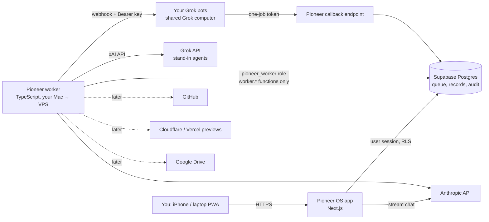
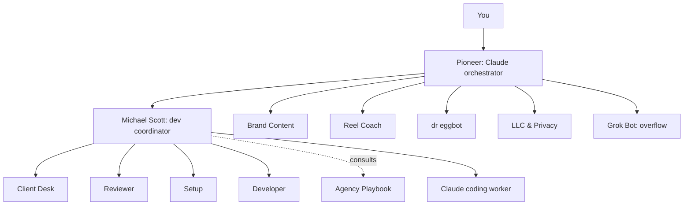
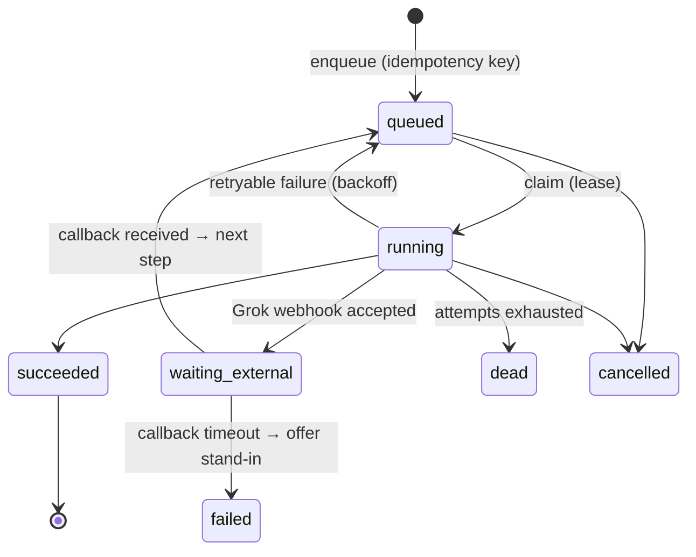

# Pioneer OS 4.0: AI workforce plan

Status: **Draft for owner review** · 2026-10-23 · Branch `docs/os4-plan`

> **Update 2026-10-24:** decisions D-29 to D-35 (`docs/decisions.md`) change parts of this draft.
> Pioneer (Claude) is the brain and Michael Scott (Grok) leads the Grok bots (§2.2); Claude runs
> through a scheduled task on the owner's subscription, not an API key (§4.2, §10); caps per
> D-33. Both outbound connections are verified. The 18-feature audit and revised phases are in
> [AUDIT_AND_PLAN.md](AUDIT_AND_PLAN.md); test steps for M1–M7 in
> [MILESTONE_REVIEW.md](MILESTONE_REVIEW.md). Where they differ, the decisions log wins.

This plan continues the existing Pioneer OS. It does not rebuild it. `docs/os3/` stays as
history. Where this plan differs from it, this plan wins once you approve it (one
authoritative version).

Nothing in this document has been implemented yet. Statements marked **verified** were
checked against the code or by running the tests on 2026-10-23. Statements marked
**unverified** must be tested before anything depends on them.

---

## 1. Verified current state (Deliverable A)

### 1.1 Baseline checks (run locally, 2026-10-23, branch `feat/m7-agent-center-foundation`)

| Check | Result |
|---|---|
| `npm audit --omit=dev` | 0 vulnerabilities |
| Lint, Prettier, typecheck | Pass |
| Unit tests (Vitest) | 167 / 167 pass, 13 files |
| Database lint | No schema errors |
| Database tests (pgTAP) | 342 / 342 pass, 10 files |
| End-to-end (Playwright) | 31 / 31 pass (production build, local Supabase) |
| Node | 24.22.0 (the "Node 20" note in `docs/architecture.md` is out of date) |

### 1.2 Feature audit

| Feature | Files | Tables | Status | Security notes | Change needed |
|---|---|---|---|---|---|
| Sign-in, MFA, sessions | `src/proxy.ts`, `src/server/auth/`, `src/app/(auth)/` | `profiles`, `workspace_members` | Built, tested | Sign-up off; TOTP; CSP nonce | None |
| Authorization | `src/server/auth/permissions.ts`, RLS in every migration | all | Built, tested | Two layers: app + RLS | Extend to new tables |
| Elevated key | `src/server/db/admin-client.ts`, `scripts/bootstrap-owner.ts` | — | Used only by bootstrap script | Server-only | Worker must **not** use it (§4.3) |
| Sales | `src/features/{clients,contacts,leads,activities,follow-ups}` | `clients`, `contacts`, `leads`, `pipeline_stages`, `activities`, `follow_ups` | Built | — | Website Demo protocol reuses `clients` with duplicate check |
| Catalog and blueprints | `src/features/{catalog,blueprints}` | `services`, `packages`, `blueprints`, `blueprint_versions`, `task_templates`, … | Built | Versions immutable | Keep; protocols link to them (§5) |
| Delivery | `src/features/projects` | `projects`, `project_tasks`, `sow_documents`, `client_input_requests`, `approvals` | Built | `approvals` are project/client approvals | Keep separate from AI action approvals |
| Operations | `src/features/operations` | `routines`, `routine_runs`, `diagnostics`, `issues`, `invoices` | Built | — | Routines later trigger protocols |
| Agent roster | `src/features/agents`, `src/app/(app)/agents/roster` | `agents` | Built | — | **M7 renamed your Grok bots** ("Michael Scott" → "Operations Agent", etc.). Restore names. Add integration state, kind, hierarchy |
| Work queue | `src/app/(app)/agents/queue` | `agent_work_items` | Built (manual copy/paste) | Owner/admin-only dispatch | Becomes the human-facing view of a job |
| Proposed actions | `action-card.tsx`, `propose-action-form.tsx` | `proposed_actions` | Built | **Approval is not bound to a payload**: only free-text `details` | Add payload + hash binding (§6) |
| Usage and budgets | `src/app/(app)/agents/usage` | `ai_usage`, `ai_budgets` | Built (manual entry) | — | Worker writes usage automatically |
| Kill switch | `ai-pause-control.tsx` | `workspaces` + `private.ai_is_paused` | Built, tested | Checked by `job_may_run` | Keep |
| Job queue | `src/app/(app)/agents/jobs`, `job-controls.tsx` | `jobs`, `job_attempts` | Built, **nothing runs jobs** | Worker role has no table access, no login | Activate (§4) |
| Provider rules | M7 migration lines 161–173 | `agents`, `ai_budgets`, `ai_usage` | Built | **xAI blocked by check constraints** | Allow `xai` again; keep Perplexity blocked |
| Audit log | `audit_events`, `private.log_event` | `audit_events` | Built, tested | Append-only | Log every job, callback and approval |

### 1.3 What the job queue already guarantees (verified in the M7 migration)

| Guarantee | Present? | How |
|---|---|---|
| Atomic claiming | Yes | `worker.claim_jobs` uses `FOR UPDATE SKIP LOCKED` |
| Leases and visibility timeout | Yes | `locked_until`, `worker.reap_expired` |
| Heartbeats | Yes | `worker.heartbeat` |
| Worker authentication | Partly | `pioneer_worker` role exists with `nologin`; needs a login and a password set by you |
| Retries and backoff | Yes | `private.job_backoff`, `max_attempts` 1–20 |
| Dead letter | Yes | status `dead` |
| Idempotency | Yes | unique `(workspace_id, kind, idempotency_key)` |
| Cancellation | Yes | `cancel_job`, owner/admin only |
| Kill switch and budget | Yes | `private.job_may_run`, `private.ai_budget_allows` |
| Audit | Yes | `job.*` events |
| **Dependencies between jobs** | **No** | Needed for protocols (§5) |
| **Waiting on an outside system** | **No** | Needed for Grok callbacks (§3.3) |

Verdict: keep the PostgreSQL queue. Redis, BullMQ and PGMQ add nothing the plan needs yet.

### 1.4 `docs/os3/` triage

| Document | Decision | Why |
|---|---|---|
| `AUTONOMY_POLICY.md` | **Preserve** | Levels 1–3 match your "low risk automatic, sensitive needs approval" choice |
| `SECURITY_AND_PRIVACY.md` | **Preserve, extend** | Add shared Grok computer risk (§3.4) and callback tokens |
| `WORKFLOW_CATALOG.md` (W1–W12) | **Preserve** | Become protocol candidates later |
| `DATABASE_SCHEMA.md` | Preserve as history | Superseded by §7 for new work |
| `IMPLEMENTATION_ROADMAP.md` | **Superseded** by §9 | Order changes |
| `ARCHITECTURE.md` §4 Hermes, `OPERATIONS_RUNBOOK.md` Hermes parts, M10 | **Postponed** | See §4.1 |
| `AGENT_ROLES_AND_PERMISSIONS.md` "eight roles via OpenRouter" | **Deprecated** | Replaced by your real roster (§3.1) |
| Decision D-24 "Grok removed" | **Reversed** (needs your sign-off as D-29) | You want your Grok bots back |
| `PIONEER_OS_SETUP_GUIDE.md` | Preserve; OpenRouter/Hermes sections postponed | Rewritten as §10 |

---

## 2. Architecture (Deliverable B)

### 2.1 Components

The app and the worker never share credentials. The app acts as **you** (your session,
RLS). The worker acts as `pioneer_worker` (no table access, only `worker.*` functions).

### 2.2 Agent hierarchy

Rule (Michael's recommendation, adopted): **Claude routes web development to Michael Scott
only.** Michael assigns Developer, Reviewer, Setup and Client Desk. Claude never assigns those
four directly, so nothing gets double-assigned. Growth and Other bots are routed by Claude
directly.

### 2.3 Job lifecycle

`waiting_external` is new (§7). A lost lease puts the job back in the queue; outside calls
carry the same idempotency key, so a retry does not send a second webhook for the same step.
Where an outside system cannot deduplicate, the worker checks the job's recorded attempts
before calling again (reconciliation).

### 2.4 Boundaries

| Actor | Can | Cannot |
|---|---|---|
| You (owner, MFA) | Everything; approve actions | — |
| App server | Act as the signed-in user; call Anthropic for chat | Use the elevated key; approve on your behalf |
| Worker | Claim/complete jobs, record usage, write results through `worker.*` | Read tables directly; approve; act while paused or over budget |
| Grok bot callback | Post a result for **one** job, once, before expiry | Read anything; touch other jobs; mark anything approved |
| Any model | Propose actions | Approve. A model saying "approved" means nothing; only your signed-in click, bound to the payload hash, counts |

---

## 3. Grok integration strategy

### 3.1 Your roster (names preserved exactly)

| Department | Bot | Pioneer role |
|---|---|---|
| Web Development | Michael Scott | Coordinator |
| | Client Desk | Briefs, scope, client drafts |
| | Reviewer | Research, QA, accessibility, security, SEO |
| | Setup | Repos, Cloudflare/Vercel, previews |
| | Developer | Implementation (see Q3 in §11) |
| | Agency Playbook | Rules, SOPs, compliance checks |
| Growth and Brand | Brand Content | Marketing copy, social ideas |
| | Reel Coach | Video/social analysis |
| | dr eggbot | Draft agent configurations |
| | LLC & Privacy | LLC admin, privacy workflows |
| Other | Grok Bot | Research, admin, overflow |

### 3.2 What is known about Grok Bot (as of 2026-10-23)

| Mechanism | Status |
|---|---|
| Routine with webhook trigger, URL + Bearer key, request body passed to the bot | Reported by xAI changelog and Michael Scott; **unverified by a real test** |
| Bot sending results back to an outside URL | **Unverified.** The bot has a browser and computer, so it probably can; must be tested |
| Completion callback built into Grok | Not documented; assume none |
| Public API to message a named bot | Not documented; assume none |
| Grok model API (xAI) | Documented; used for stand-ins |

### 3.3 Integration flow (Option B, structured handoff)

1. Worker builds an assignment: job id, step, instructions, input data, the expected result
   schema, a callback URL and a **one-job token** (random, stored only as a hash, expires in
   e.g. 2 hours, single use).
2. Worker calls the bot's routine webhook. A 2xx response sets the job to `waiting_external`.
3. The bot does the work and POSTs the result to `/api/agent-callback`, with the token.
4. The endpoint checks the token hash, expiry and job, validates the result against the
   schema, stores it as **untrusted returned content**, and queues the next step.
5. No callback before expiry → status `failed`, with the option to rerun on the stand-in.

**Integration states** (stored per agent, shown on the roster): verified connected, limited
integration, manual handoff, API-based equivalent, simulated, disconnected, error. An agent
shows "verified connected" only after a real round trip (steps 1–4) succeeds. Each bot keeps
a link to its Grok page.

**Stand-ins (Option C):** if a bot cannot complete the round trip, Pioneer creates a separate
agent "&lt;Name&gt; (Pioneer API)", using the same instructions through the xAI API. It is
labeled everywhere, so every result shows whether your bot or the stand-in did it.

**Local testing:** your Mac is not reachable from Grok's cloud. The test uses a free
Cloudflare Tunnel to a local callback URL, which is shut down afterwards.

### 3.4 Shared Grok computer (confirmed by Michael Scott)

All bots share one computer: the same files and logins (separate screens and browsers).
Michael can already see GitHub `bettyp23`. Consequences:

- **No per-bot isolation is possible.** Effective access for every bot = everything logged
  in on that computer. The Connections page shows them as one shared access group.
- Recommendation: log the Grok computer out of anything a bot does not need, and never give
  it client credentials. Pioneer hands bots data, not passwords.
- Callback tokens are per job, so a bot can only ever answer its own assignment, but any bot
  on that computer could read a token sent to another bot. Tokens are short-lived and
  results always pass validation, so the damage is limited to a bad result on one job.

---

## 4. Worker and Claude strategy

### 4.1 Worker options

| | A: TypeScript worker on the existing queue | B: Hermes worker | C: TypeScript + Hermes for bounded tasks |
|---|---|---|---|
| Reliability | Uses the tested queue directly | Hermes has its own scheduling; two sources of truth | As A, plus Hermes failure modes |
| Complexity | One small service, same language and types as the app | New system, Python, MCP bridge, Docker | Highest |
| Security | `pioneer_worker` role only | Needs agent tokens, MCP server | Both |
| Observability | Jobs page already exists | Hermes dashboard + Pioneer | Two dashboards |
| Maintenance | Low | Medium–high | High |
| Running cost | Free on your Mac; VPS later | VPS + OpenRouter | VPS + OpenRouter |
| Unique benefit | Simplest | Ready-made agent loop, Telegram | Hermes only where it clearly wins |
| Overlap with what you have | None | Queue, retries, budgets, audit | Same as B |

**Recommendation: A.** Keep the Hermes plan in `docs/os3/` as postponed. Revisit C only if a
specific task needs something Hermes provides and the Agent SDK does not.

### 4.2 Claude

- **Chat:** Next.js route handler streams replies from the Anthropic Messages API. History is
  stored in Postgres, so Claude is never the only memory.
- **Planning:** Claude returns a plan as structured output (validated with Zod): what it
  understood, protocol, steps, agents, tools, approvals needed, cost estimate. The app shows
  it as a plan card. Running it creates jobs.
- **Steps:** worker jobs of kind `claude.step` (Anthropic API), `grok.dispatch` (webhook),
  `xai.step` (stand-in), `report.compose`.
- **Models:** a cheaper model for routine steps, a stronger one for planning. Exact choice
  and per-step limits are set in config and recorded in `ai_usage`.
- **Coding worker (later, P5):** Claude Agent SDK in a throwaway container on the VPS. It gets
  one repository, through a fine-grained GitHub token limited to that repo; works on a branch;
  runs checks; reports back. It has no production credentials and no other repositories.

### 4.3 Secrets

- In `.env.local` (dev) and the host's secret store (production). Never in the repo, the
  database, chat messages or prompts.
- The database stores only the **name** of each secret (for example `ANTHROPIC_API_KEY`), for
  the Connections page.
- The worker gets its own database login (`pioneer_worker`), not the elevated key.
- Grok webhook URL and key: `GROK_ROUTINE_<BOT>_URL` / `_KEY`, worker only.

---

## 5. Blueprints, protocols and the rest

| Term | Meaning | Example |
|---|---|---|
| Blueprint | Reusable **project structure**: tasks, dependencies, inputs (exists) | "5-page website" |
| Protocol | Executable **multi-step workflow** with agents, tools, gates (new) | "Client Website Demo" |
| Skill | Reusable agent capability with instructions | "Technical SEO checklist" |
| Routine | Scheduled or event trigger (exists) | "Every Monday" |
| Task | One unit of project work, done by a person or agent (exists) | "Write homepage copy" |
| Job | One execution of one step (exists) | Attempt 2 of "research competitors" |
| Approval | Your authorization of one exact proposed action (exists, to be bound to payload) | "Send this email to X" |

A protocol can create a project from a blueprint. Blueprints are not replaced.

Protocol definitions are versioned JSON (validated by a Zod schema): objective, inputs,
steps (agent, tools, depends on, approval gate, deliverable, verification, on failure, max
retries), budget. You approve a version before it can run. Automatic improvements may change
only wording of non-authoritative instructions; anything touching tools, money, production,
client commitments or policy needs your approval.

---

## 6. Autonomy and approvals

Your choice: **low-risk tasks run automatically; sensitive actions need approval.** This maps
onto `docs/os3/AUTONOMY_POLICY.md` Level 1 (automatic) and Level 3 (approval). Level 2 rules
come later.

- **Automatic:** research, summaries, drafts, internal tasks, read-only diagnostics, record
  organization, test runs, isolated branches, preview builds (P5), approved routines.
- **Approval required:** client communication, contracts, money, pricing, production deploys,
  deletions, permission changes, data exports, legal filings, public posts.

**Binding:** `proposed_actions` gains `payload` (JSON) and `payload_sha256`. You approve a
specific hash. The executor calls `private.require_approved_action(id, hash)`, which fails if
the payload changed, the approver was not a signed-in owner, or the action already ran.

**Prompt injection:** all research results, web pages and bot replies are data. They are
never treated as instructions, never shown as approvals, and cannot add tools or raise
limits. Each protocol step lists the tools it may use; the worker refuses anything else.

---

## 7. Schema changes (only what is needed)

| Change | Milestone | Reason |
|---|---|---|
| Drop xAI check constraints; restore xAI budget row | P1 | Your Grok bots |
| `agents`: `kind` (grok_bot / api_agent / claude), `integration_state`, `external_url`, `department`, `reports_to`, `stand_in_for`, `last_verified_at`, `access_group` | P1 | Roster and states |
| Restore your 11 bot names; add Grok Bot; Claude orchestrator record | P1 | Preserve identities |
| `jobs.status` add `waiting_external`; `jobs.depends_on uuid[]` | P1 / P3 | Grok callbacks; protocol steps |
| `agent_callback_tokens` (hash, job, expiry, used_at) | P1 | Safe callbacks |
| `worker.wait_external`, `worker.record_usage`, `public.receive_callback` (security definer, token-checked) | P1 | Worker API |
| `proposed_actions.payload`, `payload_sha256`, `risk_level`; `private.require_approved_action` | P1 | Payload-bound approval |
| `connections` (app, auth type, credential owner, scopes, secret name, agents, access group, verified/expiry) | P1 (basic) / P4 (UI) | Access registry |
| `conversations`, `messages`, `message_attachments` (private Storage bucket) | P2 | Global chat |
| `protocols`, `protocol_versions`, `protocol_runs` | P3 | Protocol library |

Every new table gets RLS, grants and pgTAP tests, like M1–M7.

---

## 8. MVP (Deliverable C)

The MVP is P1 + P2 + P3. It is done when, from the chat, you can say "Pioneer, write me a
short internal report on X" and see:

1. Claude's plan card (understanding, protocol, agents, tools, approvals, estimated cost).
2. Real jobs in the queue, running in the worker on your Mac.
3. At least one step done by a real Grok bot through the webhook round trip **or** clearly
   marked as its stand-in.
4. Progress live in the chat and on the Jobs page.
5. The finished report, with cost, history and audit trail.
6. A proposed "email this report" action that runs only after your payload-bound approval.

The first test protocol is the internal research report, not a website.

---

## 9. Milestones (Deliverable D)

Each milestone gets its own branch, tests and evidence, and stops for your approval.

| # | Milestone | Main work | Needs from you |
|---|---|---|---|
| **P1** | **Live worker + real roster** | Schema changes above; TypeScript worker (`worker/`) on your Mac; `claude.step`, `xai.step`, `grok.dispatch`; callback endpoint; payload-bound approvals; roster with your names and states; Grok round-trip test with Grok Bot; jobs show cost | Anthropic + xAI API keys with spending limits, in `.env.local`; one webhook routine on Grok Bot |
| P2 | Pioneer Chat | Chat panel on every page; streaming; saved history; photo and document upload (private Storage); plan cards; job progress cards; dashboard tiles for running jobs and approvals | — |
| P3 | Protocols | Protocol library; versions; dependencies; draft-from-description; run history; the research report protocol | Approve the first protocol |
| P4 | Installable app + Connections + go-live | PWA (iPhone home screen); Connections and access page; Google Drive with folder-scoped access; then the old M8 release (production Supabase and hosting) | Hosting decision (Q5), Google OAuth app, merge approval |
| P5 | Coding worker + previews | Hostinger VPS hardened; Agent SDK in containers; fine-grained GitHub tokens; preview deploys (Cloudflare or Vercel) | VPS, GitHub tokens, preview host |
| P6 | Client Website Demo protocol | Intake → research → brief → code → preview → review → delivery, as in your brief | Approve the protocol |
| Later | os3 M12–M16 | Stripe, sales/onboarding, monitoring, self-improvement | As in `docs/os3` |

**P1 file plan:** new migration `supabase/migrations/2026102x_os4_live_worker.sql` and
`supabase/tests/011_live_worker.test.sql`; `worker/` (entry, job handlers, Anthropic/xAI/Grok
clients, unit tests); `src/app/api/agent-callback/route.ts`; roster and action changes in
`src/features/agents/`; types regenerated; Playwright test for roster states and approval
binding; docs: this plan, `docs/decisions.md` D-29 onward, `docs/schema.md`.

**Rollback:** each milestone is one forward migration plus code on its own branch. Before
merge: drop the branch. After merge: a follow-up migration reverses it; the kill switch stops
all AI work instantly; the worker can be stopped without affecting the app.

Before writing P2 code, the relevant Next.js 16 guides in `node_modules/next/dist/docs/` are
read (route handlers and streaming, PWA manifest), as `AGENTS.md` requires.

---

## 10. External setup (Deliverable E)

You set every secret yourself in `.env.local` or the host's secret settings. Never paste one
into a chat.

| Item | MVP | Website protocol | Notes |
|---|---|---|---|
| Anthropic API key + monthly spending limit | **Required** | Required | Console spending limit as a hard stop |
| xAI API key + spending limit | **Required** (stand-ins) | Required | |
| Grok Bot routine with webhook (start with "Grok Bot") | **Required** for the test | Michael Scott, Reviewer, Setup, Client Desk | Michael offered to set up the test routine |
| Clean up Grok computer logins | Strongly recommended | Required | See §3.4 |
| Cloudflare Tunnel (free) | Test only | — | Local callback test |
| Hostinger VPS | — | **Required** | P5 |
| GitHub fine-grained tokens / GitHub App | — | **Required** | Per-repo, no admin |
| Preview hosting: Cloudflare Pages or Vercel | — | **Required** | Q5 |
| Google OAuth (Drive) | Optional | Optional | P4 |
| Production Supabase + app hosting + domain | — | Before go-live (P4) | Built locally first, by your choice |
| Paid voice transcription | — | Optional | iPhone dictation for now |

### Costs

Not estimated with made-up numbers. Usage depends on how much you use it, so each provider
gets a hard spending limit in its own console, plus Pioneer's own `ai_budgets` cap, which
blocks jobs before they run. Your target is $50–150 a month overall. You decide the split
(Q1). Fixed costs: Hostinger VPS (your plan's price, from P5), production Supabase and
hosting (from P4). The worker on your Mac, Cloudflare Tunnel and Cloudflare Pages free tier
cost nothing.

---

## 11. Open decisions

| # | Question | Default if you don't decide |
|---|---|---|
| Q1 | Monthly caps: total, Anthropic, xAI | Nothing runs until set |
| Q2 | Approve reversing D-24 (Grok allowed again) as D-29 | Required for P1 |
| Q3 | Who writes code: Developer (Grok bot), the Claude coding worker, or Developer directs the Claude worker? | Developer writes the assignment, Claude worker codes, Reviewer checks |
| Q4 | Clean up logins on the shared Grok computer before P1? | Recommended |
| Q5 | Hosting for the Pioneer app (Vercel Pro or Cloudflare) and client previews (Cloudflare Pages or Vercel) | Cloudflare Pages for previews, as Michael suggested; app hosting decided at P4 |
| Q6 | Merge M1–M7 to `main` before P1 starts? | P1 branches from M7 |

## 12. Risks

| Risk | Mitigation |
|---|---|
| Grok webhook or callback does not work as reported | Stand-ins; integration state shows the truth |
| Shared Grok computer: one bot's access is every bot's access | §3.4; nothing sensitive logged in there |
| Prompt injection from researched web pages | Results are data; per-step tool allowlist; approvals bound to payload |
| Runaway spending or agent loops | Provider limits, `ai_budgets`, `max_attempts`, protocol retry limits, kill switch |
| Duplicate outside actions after a crash | Idempotency keys, reconciliation before retry |
| Your Mac sleeping stops the worker | Fine for MVP; VPS in P5 |
