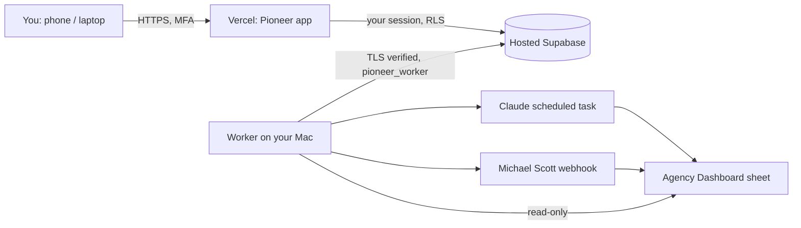

# Hosted Pioneer (Vercel + Supabase) with the worker on your Mac

The Vercel site (`pioneer-crm-two.vercel.app`) is the real Pioneer: you use it from your phone or
laptop. The hosted Supabase project holds the real data. Michael Scott messages are sent by the
app itself, and his replies come back to `POST /login/api/reply` (see below). The Mac worker is
still how Claude messages go out and how a Pioneer Results file gets into the chat. It can also
send to Michael; if it is running at the same time as the app, only one of them sends each
message. The copy on your Mac (`npm run dev`, local database) stays for testing.



Never paste a password, key, token or connection string into a chat.

## Hosted relay (Michael Scott, no Mac)

Apply migration `supabase/migrations/20261116000100_hosted_relay.sql` to the hosted database
before the relay can call it. Then set these names on the Vercel project (Preview to try it,
Production only when you mean to turn it on). Values stay in the dashboard. Do not put them in
the repo or in a chat.

| Name | Where |
|---|---|
| `NEXT_PUBLIC_SUPABASE_URL` | Vercel. Already set for the app. |
| `NEXT_PUBLIC_SUPABASE_PUBLISHABLE_KEY` | Vercel. Already set for the app. |
| `SUPABASE_SECRET_KEY` | Vercel. The Supabase secret key (service_role). `SUPABASE_SERVICE_ROLE_KEY` is the same value if that is the name already stored. Set one. |
| `GROK_WEBHOOK_URL` | Vercel. Same https webhook the Mac worker uses. |
| `GROK_WEBHOOK_KEY` | Vercel. Bearer token for that webhook. |
| `PIONEER_REPLY_KEY` | Vercel, and the same value wherever Michael sends the reply. A long random string. |

Reply request, on the deployment that has the key (preview host, or
`https://pioneerdigitalai.com` once this is in production):

```
POST /login/api/reply
Authorization: Bearer <PIONEER_REPLY_KEY>
Content-Type: application/json

{
  "job_id": "<uuid from the webhook>",
  "code": "<one-time code from the webhook>",
  "from": "michael_scott",
  "kind": "result",
  "text": "<the reply shown in the dashboard>"
}
```

`kind` may also be `needs_decision`. `client` is optional. The response is JSON
`{ "outcome": "accepted" }`, `"duplicate"`, or `"ignored: <reason>"` (wrong code, expired, and
the other reasons `worker.accept_result` already returns). A bad key is `401`. The login proxy
forwards `Authorization` on `/login/*`.

If `GROK_WEBHOOK_URL` or `GROK_WEBHOOK_KEY` or the Supabase secret is missing, the app leaves the
message queued. It does not fail the job.

## 1. Supabase dashboard (your project)

1. **Authentication → Sign In / Providers → Email:** turn **off** "Allow new users to sign up".
   Keep email + password on.
2. **Authentication → Multi-Factor:** TOTP **enabled**.
3. **Authentication → Password security:** minimum length **12**, leaked-password protection
   **on**.
4. **Authentication → URL Configuration:** Site URL `https://pioneer-crm-two.vercel.app`;
   redirect URLs: the same address followed by `/**`.
5. **Database → Settings → SSL configuration:** **Download certificate**, then in Terminal:
   ```bash
   mkdir -p ~/.config/pioneer && mv ~/Downloads/prod-ca-*.crt ~/.config/pioneer/supabase-ca.crt
   ```

## 2. Link this Mac to the project (Terminal, in the project folder)

```bash
npx supabase login
npx supabase link --project-ref haorcxcglsilmzqdltrc
```

`login` opens the browser. `link` asks for the database password (from your password manager;
reset it under Database settings if you don't have it). Then tell Claude Code "linked": it checks
which migrations the hosted database already has and shows you before changing anything.

## 3. Database changes (after M8 is merged)

Claude Code runs `npx supabase db push` once you approve. This applies the migrations only;
**the local sample data (`seed.sql`) is never sent to the hosted database**, because its
passwords are public.

## 4. Your owner account (once)

If you haven't signed in to the Vercel site yet: follow `docs/runbooks/bootstrap-owner.md` with
the hosted project's URL and secret key. Remove the secret key from `.env.local` afterwards.

## 5. The worker → hosted database

```bash
npm run worker:setup-hosted
```

It asks for the **Session pooler** connection string (Supabase → **Connect** → Session pooler,
with your database password filled in). You type it hidden; it's used once and not saved. The
script gives `pioneer_worker` a new random password, checks that the worker can log in with the
certificate verified, and saves only the worker's login to `.env.worker`. Then:

```bash
npm run worker
```

The first log line should say `"database":"hosted (TLS verified)"`.

## 6. Vercel settings

- **Environment variables:** only `NEXT_PUBLIC_SUPABASE_URL` and
  `NEXT_PUBLIC_SUPABASE_PUBLISHABLE_KEY`. Never the Supabase secret key, and none of the worker
  settings.
- **Deployment Protection:** on for **Preview** deployments (Vercel Authentication), so branch
  previews aren't public. The production address stays reachable and is protected by your
  login and authenticator code.
- **Plan:** Vercel's Hobby plan is for non-commercial use; Pioneer runs your business, so it needs
  Pro.

## 6b. Public `/login` path

The marketing site stays on Cloudflare Pages. The CRM is reached only at
`https://pioneerdigitalai.com/login` (and paths under it) by the worker in
`cloudflare/login-proxy`. Deploy that worker only after this app's production deployment is
READY and `node cloudflare/login-proxy/preflight.mjs` passes.

Do not add `pioneerdigitalai.com` as a domain on the CRM project, and do not change the
Supabase site URL to that host. Password sign-in does not use the site URL. A redirect from
the Vercel host to the public host loops through the proxy.

## 7. Live test

On your phone: open the site → **Pioneer** → "draft a follow-up for test client" → Send. Within
a few minutes Pioneer's routing note, then Michael Scott's result, appear in the chat.

## Notes

- Supabase's free plan pauses projects after a week without activity and has no backups. For
  real client data, use the Pro plan.
- To test locally again, run `npm run worker:setup-local`; it switches `.env.worker` back to the
  local database. `npm run worker:setup-hosted` switches it to the hosted one.
