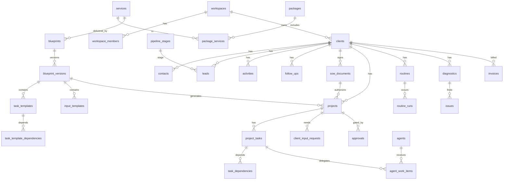

# Pioneer OS — MVP Schema

Status: **M1 as-built** (§3, §9) · later sections proposed · Last updated: 2026-10-20

This is the target schema across milestones. Each milestone migrates only its own tables.
The SQL in `supabase/migrations/` is authoritative once it exists; this document explains
intent and is updated alongside migrations.

## 1. Conventions

- Postgres schema `public` for tables exposed via the Data API; `private` (not exposed) for
  helper functions and trigger functions.
- Primary keys: `id uuid primary key default gen_random_uuid()`. Exception: `audit_events`
  uses `bigint generated always as identity`.
- Every business table has `workspace_id uuid not null references workspaces(id)` and an
  index on it. Child tables use **composite foreign keys** `(workspace_id, parent_id)` to
  make cross-workspace references impossible.
- `created_at timestamptz not null default now()`, `updated_at` maintained by trigger,
  `created_by uuid references auth.users(id)` where meaningful.
- Archive, don't delete: business records have `archived_at timestamptz`. Hard delete is
  owner-only and audited.
- Enums: Postgres `enum` types for fixed lifecycles (statuses); lookup tables for things
  the owner configures (pipeline stages).
- Money: `amount_minor bigint` + `currency char(3)` (default `'USD'`). All price/amount
  columns are nullable — values are owner-entered, never generated.
- Links: `*_url text` with a check constraint restricting to `https://` and, for Drive
  links, the hosts `drive.google.com` / `docs.google.com`.
- Optimistic concurrency: rule-bearing rows (tasks, projects, approvals) carry
  `version int not null default 1`, incremented by trigger.
- Names: constraints are named explicitly (`clients_name_not_blank`) so the app can map
  errors to messages.

## 2. Entity overview



## 3. Milestone 1 — foundation (as built)

Migrations: `20261020000100_extensions_and_private.sql`, `20261020000200_workspaces.sql`,
`20261020000300_audit.sql`. Tests: `supabase/tests/*.test.sql` (61 pgTAP assertions).

### `workspaces`
| Column | Type | Notes |
|---|---|---|
| id | uuid PK | |
| name | text not null | `workspaces_name_not_blank`: 1–120 chars after trim |
| slug | text not null unique | `^[a-z0-9-]{2,40}$` |
| timezone | text not null default `'America/New_York'` | IANA name (D-11); `workspaces_timezone_valid` via `private.is_valid_timezone` |
| created_at, updated_at | timestamptz | |

### `profiles`
| Column | Type | Notes |
|---|---|---|
| user_id | uuid PK → `auth.users(id)` on delete cascade | |
| display_name | text not null | `profiles_display_name_not_blank`: 1–120 chars |
| created_at, updated_at | timestamptz | |

### `workspace_members`
| Column | Type | Notes |
|---|---|---|
| workspace_id | uuid → workspaces | PK part |
| user_id | uuid → `profiles(user_id)` on delete restrict | PK part; via profiles so the roster can be listed with names |
| role | `workspace_role` enum: `owner`, `admin`, `member`, `viewer` | |
| status | `member_status` enum: `active`, `suspended` | |
| created_at, updated_at | timestamptz | |

Trigger `prevent_last_owner_removal`: rejects delete/demote/suspend of the last active owner
(SQLSTATE `23514`, constraint `workspace_members_last_owner`). It locks the workspace row so
concurrent owner changes serialize.

RLS (all with a restrictive `aal2` policy):

| Table | select | insert | update | delete |
|---|---|---|---|---|
| `workspaces` | viewer+ | — (bootstrap script only) | owner (`name`, `timezone` columns) | — |
| `profiles` | self or co-member (`private.shares_workspace`) | — | self (`display_name`) | — |
| `workspace_members` | viewer+ | owner | owner (`role`, `status`) | owner |

### `audit_events` (append-only)
| Column | Type | Notes |
|---|---|---|
| id | bigint identity PK | |
| workspace_id | uuid → workspaces | |
| occurred_at | timestamptz default now() | |
| actor_type | `actor_type` enum: `user`, `system`, `agent` | |
| actor_user_id | uuid null → auth.users (no ON DELETE action) | set from `auth.uid()` by `log_event` |
| actor_agent_id | uuid null → agents (added M6) | |
| action | text not null | e.g. `client.updated`, `blueprint_version.published` |
| entity_type | text not null | table name |
| entity_id | uuid null | |
| changes | jsonb | `{column: [old, new]}` for updates; snapshot for insert/delete |
| context | jsonb | request id, RPC name, reason text |

- No `INSERT/UPDATE/DELETE` grants to `authenticated`. Rows are written only by
  `private.audit_row_change()` (trigger) and `private.log_event()`, both `security definer`
  with `search_path = ''`.
- `SELECT` for owner/admin of the workspace.
- Sensitive columns are excluded from `changes` by a per-table allowlist.
- Index `(workspace_id, occurred_at desc)` and `(entity_type, entity_id)`.
- Triggers `prevent_audit_mutation` reject UPDATE/DELETE/TRUNCATE for every role, including
  `postgres`.
- M1 audited tables: `workspaces` (insert/update of `name`, `slug`, `timezone`) and
  `workspace_members` (insert/update/delete of `user_id`, `role`, `status`). Actions:
  `workspace.created|updated`, `workspace_member.created|updated|deleted`. Writes without a
  user JWT (bootstrap script, seed) are `system` events.

### Helper functions (`private` schema)
- `private.role_rank(workspace_role) → int`
- `private.has_role(ws uuid, min_role workspace_role) → boolean` — `security definer`,
  `stable`, `search_path=''`; checks active membership for `(select auth.uid())`.
- `private.is_mfa() → boolean` — `(select auth.jwt()->>'aal') = 'aal2'`.
- `private.shares_workspace(other_user uuid) → boolean` — `security definer`; caller and
  `other_user` are both members of a common workspace (profile visibility).
- `private.is_valid_timezone(text) → boolean` — used by `workspaces_timezone_valid`.
- `private.prevent_last_owner_removal()`, `private.audit_row_change()`,
  `private.log_event(...)`, `private.prevent_audit_mutation()`.
- `bump_version()` is created in M1 but first used in M4.
- `private.set_updated_at()`, `private.bump_version()` triggers.

## 4. Milestone 2 — clients and pipeline

| Table | Key columns | Constraints / notes |
|---|---|---|
| `clients` | name, legal_name, kind (`organization`/`individual`), status `client_status` (`prospect`,`active`,`paused`,`former`), industry, website_url, drive_folder_url, notes, archived_at | name non-blank; Drive URL host check; trigram index on name for search |
| `contacts` | client_id, first_name, last_name, email (`citext`), phone, job_title, is_primary, notes, archived_at | composite FK to client; partial unique `(client_id) where is_primary` |
| `pipeline_stages` | name, position, kind (`open`,`won`,`lost`) | unique `(workspace_id, position)`; seeded: Inquiry, Discovery, Proposal, Negotiation, Won, Lost (owner may rename — D-3) |
| `leads` | client_id, primary_contact_id, title, source, stage_id, estimated_value_minor, currency, expected_close_on, owner_user_id, lost_reason, closed_at | `lost_reason` required when stage kind = lost (trigger); stage changes audited |
| `activities` | client_id, lead_id?, contact_id?, project_id? (FK added M4), type (`note`,`call`,`email`,`meeting`), subject, body, occurred_at | immutable after 24 h except by owner (proposal) |
| `follow_ups` | client_id, lead_id?, contact_id?, title, due_at, status (`open`,`done`,`cancelled`), assignee_user_id, completed_at | `completed_at` set iff status=done (check) |

## 5. Milestone 3 — catalog and blueprints

| Table | Key columns | Constraints / notes |
|---|---|---|
| `services` | code, name, description, category, list_price_minor?, currency, is_active | unique `(workspace_id, code)` |
| `packages` | name, description, list_price_minor?, currency, is_active | |
| `package_services` | package_id, service_id, quantity, position | PK `(package_id, service_id)` |
| `blueprints` | service_id?, name, description, archived_at | |
| `blueprint_versions` | blueprint_id, version_number, status (`draft`,`published`,`retired`), change_summary, content_hash, published_at, published_by, retired_at | unique `(blueprint_id, version_number)`; partial unique `(blueprint_id) where status='draft'`; immutability trigger |
| `task_templates` | blueprint_version_id, key, title, description, phase, position, estimated_hours?, due_offset_days?, requires_approval, approval_approver (`internal`,`client`) | unique `(blueprint_version_id, key)`; `key` `^[a-z0-9_]+$`; writes rejected unless parent is draft |
| `task_template_dependencies` | blueprint_version_id, task_template_id, depends_on_id | composite FKs force same version; check not self; acyclicity checked at publish |
| `input_templates` | blueprint_version_id, key, label, description, input_kind (`file`,`text`,`access_confirmation`,`decision`), required, blocks_task_template_id? | `access_confirmation` records *that* access was granted and *where* the credential lives (e.g., password-manager item name) — never the credential |

RPC: `create_draft_version(blueprint_id, from_version_id?)` (copies a version into a new
draft), `publish_blueprint_version(version_id)`, `retire_blueprint_version(version_id)`.

## 6. Milestone 4 — projects and delivery

| Table | Key columns | Constraints / notes |
|---|---|---|
| `sow_documents` | client_id, title, version_label, drive_url, status (`draft`,`sent`,`signed`,`superseded`,`void`), signed_on, client_signatory, supersedes_id?, scope_summary | when signed: `signed_on` + `client_signatory` required (check); trigger blocks edits except status → superseded/void |
| `projects` | client_id, lead_id?, sow_id?, blueprint_version_id, name, status (`active`,`on_hold`,`completed`,`cancelled`), start_on, target_end_on, idempotency_key, generated_by, version | `idempotency_key` unique; FK to blueprint version must be published at generation (checked in RPC); `sow_id` required unless `no_sow_reason` given (D-6) |
| `project_tasks` | project_id, source_template_id?, key, title, description, phase, position, status `task_status` (`todo`,`in_progress`,`in_review`,`on_hold`,`done`,`cancelled`), assignee_user_id?, due_on?, requires_approval, started_at, completed_at, version | unique `(project_id, key)`; `status` not directly updatable (column grants) |
| `task_dependencies` | project_id, task_id, depends_on_task_id | composite FKs same project; not self; cycle check on insert (manual additions) |
| `client_input_requests` | project_id, source_template_id?, label, input_kind, status (`requested`,`received`,`accepted`,`rejected`,`waived`), drive_url?, blocks_task_id?, requested_at, received_at, decided_at, waive_reason | `waive_reason` required when waived |
| `approvals` | project_id, task_id?, subject (`task`,`deliverable`,`project_phase`), approver_type (`internal`,`client`), status (`pending`,`approved`,`rejected`,`withdrawn`), requested_by, decided_by_user_id?, client_contact_id?, evidence_url?, decision_note, decided_at, version | client approvals require `client_contact_id` + `evidence_url`; decided rows immutable |

Views (`security_invoker = true`): `task_readiness` (task, is_ready, blockers jsonb),
`project_progress` (counts by status, % done, overdue count).

RPC: `generate_project(...)`, `transition_task(task_id, to_status, expected_version)`,
`request_approval(...)`, `decide_approval(approval_id, decision, note, evidence_url, expected_version)`,
`update_input_request_status(...)`.

Transition graph (`transition_task`):
```
todo ──► in_progress ──► in_review ──► done
 │  ▲         │   ▲          │
 │  └─────────┘   └──────────┘   (send back)
 ├──► on_hold ◄──► (todo | in_progress)
 └──► cancelled  (from any non-done; owner/admin; reason required)
```
`→ in_progress` requires all prerequisites `done` (cancelled prerequisites: D-7) and all
blocking inputs `accepted`/`waived`. `→ done` additionally requires an `approved` approval
when `requires_approval`.

## 7. Milestone 5 — operations

| Table | Key columns | Constraints / notes |
|---|---|---|
| `routines` | client_id?, project_id?, name, description, cadence (`daily`,`weekly`,`monthly`,`quarterly`,`yearly`), interval_count, anchor_on, owner_user_id, runbook_url?, is_active, next_due_on | |
| `routine_runs` | routine_id, scheduled_for (date), status (`pending`,`done`,`skipped`,`failed`), completed_by, completed_at, notes, evidence_url? | unique `(routine_id, scheduled_for)` |
| `diagnostics` | client_id, project_id?, diagnostic_type, performed_on, performed_by, summary, score?, report_url? | `diagnostic_type` lookup or enum decided in M5 |
| `issues` | client_id, project_id?, diagnostic_id?, title, description, severity (`low`,`medium`,`high`,`critical`), status (`open`,`triaged`,`in_progress`,`resolved`,`wont_fix`), assignee_user_id, opened_at, resolved_at, resolution | `resolved_at` iff resolved/wont_fix |
| `invoices` | client_id, project_id?, external_system, external_number, external_url?, issued_on, due_on, amount_minor, currency, status (`draft`,`sent`,`paid`,`overdue`,`void`), paid_on | unique `(workspace_id, external_system, external_number)`; **metadata only** |

Reporting views (`security_invoker = true`): `pipeline_summary`, `project_health`,
`overdue_tasks`, `routine_compliance`, `open_issues_by_severity`, `receivables_by_status`.

## 8. Milestone 6 — agent work queue

| Table | Key columns | Constraints / notes |
|---|---|---|
| `agents` | name, kind (`grok_bot`,`other`), description, is_active, allowed_work_types text[] | no auth identity |
| `agent_work_items` | agent_id, project_task_id?, work_type, title, instructions, context_snapshot jsonb, sensitivity_flags jsonb, status (`draft`,`ready`,`dispatched`,`returned`,`accepted`,`rejected`,`cancelled`), prepared_by, dispatched_by, dispatched_at, output_text, output_url, returned_at, reviewed_by, reviewed_at, review_note, version | status changes only via RPC; `context_snapshot` frozen at `ready` (trigger) |

## 9. Grants summary

- `anon`: no privileges on any table, view, sequence or function in `public`.
- `authenticated`: table privileges granted per table (typically `select, insert, update`
  with column lists); `delete` only where hard delete is intended. All gated by RLS.
- `service_role`: used only by `scripts/bootstrap-owner.ts` and migrations.
- `alter default privileges` revokes automatic grants on new objects so every grant is explicit.

## 10. RLS policy template

```sql
alter table public.clients enable row level security;

-- MFA required for every business table (restrictive = AND-ed with others)
create policy clients_require_mfa on public.clients
  as restrictive for all to authenticated
  using ((select private.is_mfa())) with check ((select private.is_mfa()));

create policy clients_select on public.clients
  for select to authenticated
  using ((select private.has_role(workspace_id, 'viewer')));

create policy clients_insert on public.clients
  for insert to authenticated
  with check ((select private.has_role(workspace_id, 'member')));

create policy clients_update on public.clients
  for update to authenticated
  using ((select private.has_role(workspace_id, 'member')))
  with check ((select private.has_role(workspace_id, 'member')));
```

Each table's policies are covered by pgTAP tests for: anon, authenticated non-member,
viewer, member, admin, owner, and an `aal1` session.
